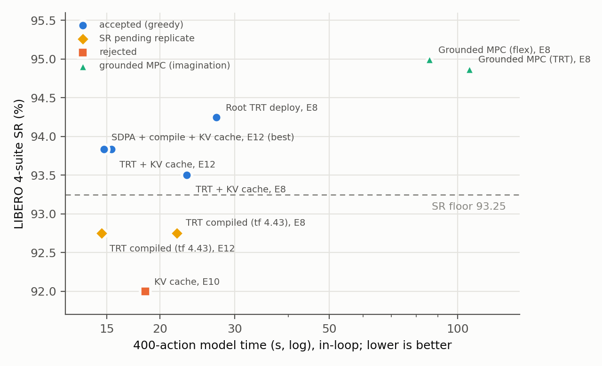
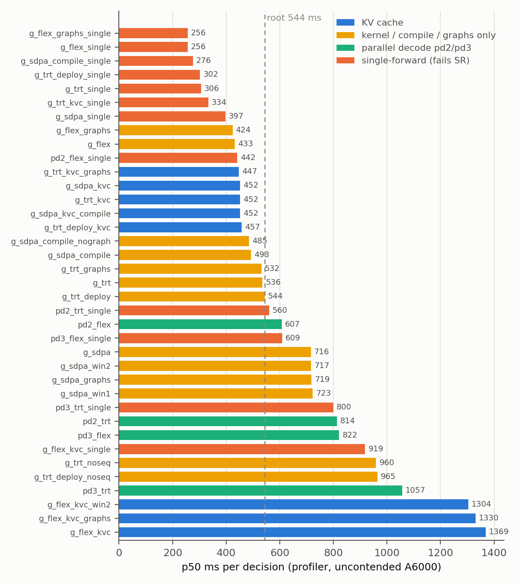
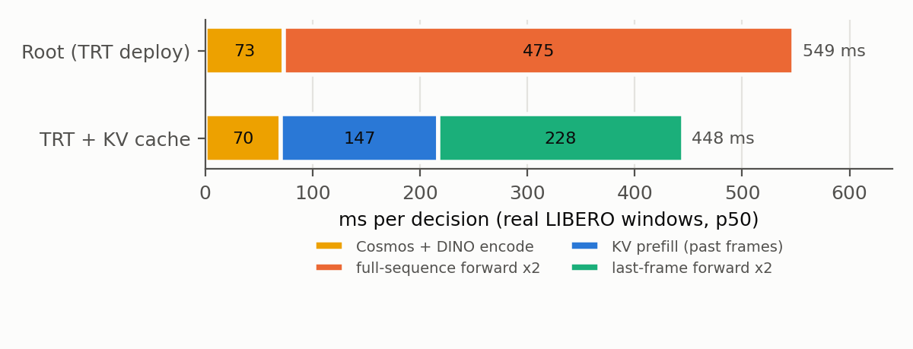
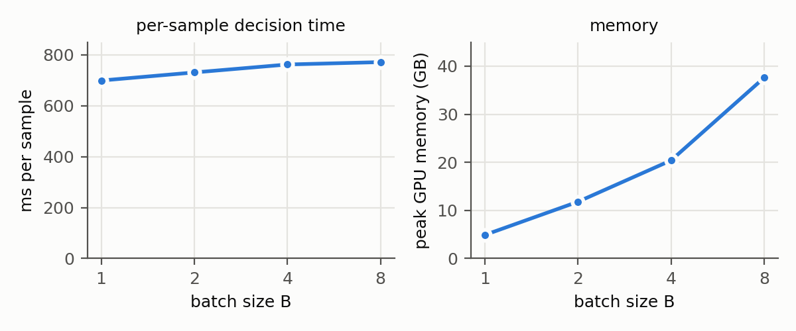
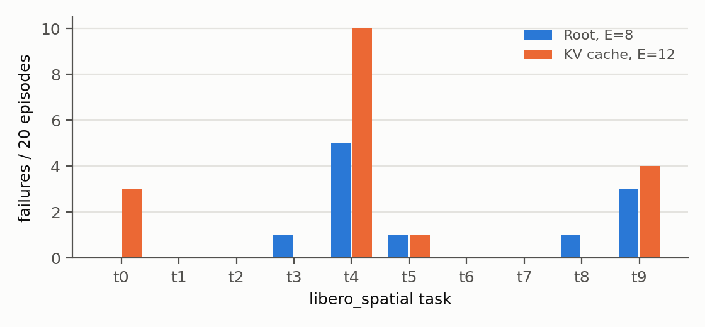
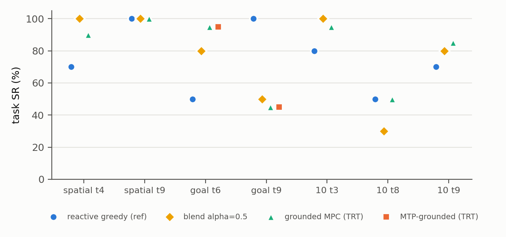

# Inference speed vs success rate: full configuration study

Model `wl_ms_dcp_4suite_chunk16_warm_ciai_100k` (h1024 L16, ~758M params, chunk 16), LIBERO 4 suites, RTX A6000.
Study run 2026-10-13/14. Figures: `figures/inference_study/` (regenerate with `figures/make_inference_study.py`, which
reads only result files on disk).

## 1. Result

| Operating point | SR, 4-suite | ms / decision (in-loop) | 400-action model time | vs root |
|---|---|---|---|---|
| Greedy root: TRT + compile + graphs, E=8 (`transformers` 5.17) | 94.3 | 543 | 27.2 s | 1.00x |
| TRT + KV cache (`INFER_CACHE=1`), E=8 | 93.5 | 462 | 23.1 s | 1.18x |
| SDPA + compile + KV cache, E=8 | 93.5 (identical per suite) | 443 | 22.1 s | 1.23x |
| TRT + KV cache, E=12 | 93.8 | 462 | 15.4 s | 1.77x |
| **SDPA + compile + KV cache, E=12 (selected)** | **93.8** | **443** | **14.8 s** | **1.84x** |
| TRT + compiled transformer, `transformers` 4.43, E=8 / E=12 | 92.75 / 92.75 (replicate pending) | 438 | 21.9 / 14.6 s | 1.24x / 1.86x |
| Grounded MPC (flex), E=8 | 95.0 (800 episodes) | 1717 | 85.9 s | 0.32x |
| Grounded MPC (TRT), E=8 | 94.9 (800 episodes) | 2132 | 106.6 s | 0.26x |



*Figure 1. Closed-loop SR against 400-action model time (log). Blue: accepted greedy configurations; yellow:
`transformers` 4.43 runs awaiting a replicate; red: rejected; green: grounded MPC. Dashed: acceptance floor.*

Selected configuration (reference eval recipe plus):
```
INFER_CACHE=1  --attention_backend sdpa --compile --compile_scope predictor --seq_cache --replan_steps 12 --exec_steps 12
```
It produces exactly the actions of the accepted TRT + KV cache node (so it shares its SR), needs no TensorRT engine,
and runs in the standard eval venv (`/nvme-data/flexpi-eval-venv`). CUDA graphs add nothing on the KV-cache path.

Two ends of the trade-off: grounded MPC is the highest-SR point (95.0) at 5.8x the cost of the selected
configuration; its gain is a swap between tasks rather than a uniform improvement (section 9).

## 2. Setup

- **Recipe (fixed):** policy_ctx 0, hold 1, gripper rescale_flip + binarize, num_steps_wait 10, greedy action decode
  (action_n_iter 1, temp 0, cfg 1.0), `--seq_cache` on, 10 tasks x 10 trials per suite.
- **SR acceptance (fixed before results):** 4-suite average >= root reference - 2 points (floor 93.25) and no suite
  more than 5 points below the root reference (.97 / 1.00 / .94 / .90).
- **SR runs:** each suite split into task shards run as separate processes on one GPU (2-3 per GPU, 10 pinned
  cores each). Episodes are identical to a single-process run; only throughput changes.
- **Latency:** two measurements.
  - Profiler (`profile/profile_policy.py`, same as the baseline comparison table): p50 of 30 decisions after 10
    warmup, uncontended GPU, all 37 configurations.
  - In-loop: the eval's own synchronized per-decision timer, uncontended, with warmup cancelled by differencing a
    2-trial and an 8-trial run of the same task. Profiler and in-loop agree for the root (544 vs 543 ms).
- **400-action model time** = 400 / E x ms per decision (simulation excluded), as in `results/local/END_TO_END_LATENCY.md`.
- **Determinism:** the closed loop is deterministic given the actions. Two stacks with identical actions give
  identical per-suite SR (TRT + KV cache and SDPA + compile + KV cache: .95 / 1.00 / .94 / .85 both). Run-to-run SR
  differences come from numerical differences between stacks (kernels, library versions), not simulator randomness.

## 3. Decode facts and fixes

Verified on the real checkpoint and real LIBERO validation windows (`results/local/inference_study/decode_fix_verification.json`).

- The action stream is **3 tokens** (one per token-frame, T=9 frames with 4x temporal compression); only the last is
  executed. Parallel decode commits at least one token per iteration, so at most 3 decode forwards can matter.
- **Early exit in parallel decode.** The old loop ran all k iterations: pd8 = 9 forwards, 5 of them no-ops. It now
  stops once every token is committed. Output is bit-identical to the old code for k = 1, 2, 4, 8 at temp 0 and 1;
  forwards pd4 5 -> 4, pd8 9 -> 4.
- **Parallel decode + KV cache.** `INFER_CACHE` used to route to a cached greedy loop that ignored `--parallel_decode`.
  It now runs the same parallel-decode update over the cache (ids identical to the uncached decode on the same
  tokens). Since the cached path decodes only the last action token, pd_k is a no-op there.
- **Parallel decode + single-forward lever.** `skip_final` used to disable parallel decode silently; it is now
  honoured (one fewer forward, ids unchanged).
- **pd1 is greedy.** With action_temp 0 the categorical sample is argmax and one iteration does no re-masking. pd1
  (TRT, E=8) scored .95 / 1.00 / .93 / .86 = 93.5 at ~542 ms, within the spread of greedy runs.
- `INFER_CACHE=1` and `WL_ACTION_PREFIX_CACHE=1` select the same action-decode path (`generate.py:367`);
  `INFER_CACHE` additionally caches per-frame video generation, which grounded MPC uses (section 9).

## 4. Latency of every configuration



*Figure 2. Profiler p50 ms per decision for all measured configurations (`transformers` 5.17; 37 ran, two compile modes
crashed). Colour = lever family. Dashed line: root.*

| Family | Fastest member | ms / dec | vs root | Status |
|---|---|---|---|---|
| Single-forward | flex + single-forward | 256 | 2.13x | SR fails (goal 0.70, long 0.57) |
| Flex, no cache | flex + graphs | 424 | 1.28x | flex + graphs crashes in closed loop (task 4->5); plain flex 433 ms untested in closed loop |
| **KV cache** | TRT / SDPA + KV cache (+graphs/compile) | 447-457 | 1.20x | **SR accepted**; all variants action-identical |
| SDPA + compile | no graphs | 485 | 1.12x | no SR run; compile only helps SDPA without the cache |
| TRT | plain / graphs / deploy | 532-544 | 1.00x | root |
| Parallel decode | pd2 flex | 607 | 0.90x | only useful as SR repair |
| SDPA plain | sdpa, sdpa + graphs | 716-719 | 0.76x | |

Findings:
- **Layout cache is essential:** turning `--seq_cache` off costs 960 vs 536 ms (TRT).
- **KV cache is backend-independent:** TRT, SDPA, +graphs, +compile all land at 447-457 ms (profiler) with identical
  actions (200/200 windows, max difference 0). In-loop, SDPA + compile is slightly faster (443 vs 462 ms).
- **Flex must not be combined with the KV cache:** 1304-1369 ms, 3x slower than without it.
- **Compile and graphs barely matter on TRT under `transformers` 5.17** (532-544 ms): the transformer compile is
  skipped there (section 6).
- **Compile modes `reduce-overhead` and `max-autotune` crash** (inductor CUDA-graph outputs overwritten by a later run).
- **Sliding-window attention gives nothing** (717-723 ms vs 716): it is applied to the dense SDPA mask, which still
  computes every block.

## 5. Where the time goes



*Figure 3. One greedy decision split into stages, real LIBERO windows (p50). Sequence build, offset head and VQ decode
are under 1 ms and omitted.*

- The predictor is 85% of a decision; Cosmos + DINO encoding is 13%.
- The root runs two full-sequence forwards (238 ms each): one to decode the action tokens and one clean pass whose
  hidden state feeds the continuous action offset.
- The KV cache replaces them with a prefill of the two past frames (147 ms) and two last-frame forwards (114 ms each).
  A last-frame forward handles a third of the queries but costs half a full forward; ~80 ms would be expected. The
  cached path falls back to SDPA per shape, which is the likely cause.
- Dummy inputs and real inputs time within 3% of each other, so profiler and in-loop numbers are comparable.

## 6. The latency regression since 2026-09-25 (resolved)

The reference eval `AUTO_sr_scan/4suite_chunk16_warm_exec8_100k` (TRT backend per its logs and `sr.json`) logged
447 ms/decision; the same flags measured 543 ms on 10-13. Cause: `flexpi-eval-venv` was upgraded to
`transformers` 5.17.0 on 09-29. Under 5.x, compiling the Chameleon transformer with TRT attention crashes
(`index_select` on a `None` hidden at `forward.py:96` with predictor scope; `TRTAttention` untraceable with
transformer scope), so `forward.py` skipped the transformer compile for TRT and the speedup was lost silently.

| Environment | Transformer compile on TRT | ms / decision |
|---|---|---|
| Reference run, 09-25 | compiled | 447 (in-loop) |
| `transformers` 4.43.3 (`/media/mbzuaiser/SSD1/worldlab-eval-venv`) | **compiled** | **438** (in-loop), 440 (profiler) |
| `transformers` 4.43.3, compile skipped | skipped | 537 (profiler) |
| `transformers` 5.17.0, compile forced | crash | - |
| `transformers` 5.17.0 (current) | skipped | 543 (in-loop) |

Fix applied: `forward.py` now skips the TRT transformer compile only when `transformers` >= 5. Both venvs have the
same simulator stack (MuJoCo 3.3.0, robosuite 1.4.0, numpy 1.26.4) and TensorRT 10.9.

Action equivalence on 200 real windows (`tts_tree_100k/tf443/equiv/EQUIV.md`):

| Pair | Max action difference | Windows > 0.02 |
|---|---|---|
| 4.43 compiled vs 4.43 uncompiled | 0.0078 | 0 (compile does not change actions) |
| 4.43 vs 5.17 | 0.98 | 7 (6 small offset drifts 0.021-0.055, 1 action-code flip) |

Closed-loop SR under 4.43 + compiled transformer (TRT): E=8 .94 / 1.00 / .90 / .87 = 92.75; E=12 .91 / .99 / .94 / .87
= 92.75. These are below the floor although the policy is near-identical to the 5.17 root (94.3): a 400-episode
4-suite SR has a standard error of ~1.2 points (95% CI about +-2.3), so greedy runs of near-identical policies span
92.75-95.25. A replicate (800 episodes) is needed before accepting or rejecting the 4.43 configuration.

## 7. Batch evaluation



*Figure 4. Decision time per sample and peak memory vs batch size (same real window repeated, SDPA).*

Per-sample time rises with batch size (699 -> 771 ms from B=1 to B=8) while memory grows to 37.6 GB: a single
9.3k-token forward already saturates the GPU. Batched inference is therefore not used; SR throughput comes from
running task shards of a suite as parallel processes, which overlaps CPU simulation with GPU decoding.

## 8. SR tree and the E=12 replicate

One lever added at a time; each level expands from the best accepted node; decisions on all 4 suites
(`tts_tree/tts_tree.py --sr_only`, `TTS_TREE.md`). Kernel-only levers were not SR-tested (they do not change actions).

| Node | spatial | object | goal | long | Avg | Decision |
|---|---|---|---|---|---|---|
| Root (re-measured) | 0.95 | 1.00 | 0.92 | 0.90 | 94.3 | baseline (reference run 95.25) |
| + single-forward | - | - | 0.70 | 0.57 | <= 81.8 | rejected (bound) |
| + KV cache, E=8 | 0.95 | 1.00 | 0.94 | 0.85 | 93.5 | accepted |
| + KV cache, E=12 | 0.89 -> **0.903 pooled** | 0.99 | 0.96 | 0.90 | **93.8** | accepted on replicate |
| + KV cache, E=10 | 0.92 | 1.00 | 0.90 | 0.86 | 92.0 | rejected (average) |



*Figure 5. Failures per spatial task over 20 episodes each (trials 1-10 = original init states, 11-20 = new ones),
same episodes for both configurations.*

| Config | Trials 1-10 | Trials 11-20 (new init states) | Total |
|---|---|---|---|
| Root, E=8 | 95/100 | 94/100 | 94.5% |
| KV cache, E=12 | 90/100 | 92/100 | 91.0% |

- Reproducible: E=12 scored 89 then 90 on the original init states; the root 95 and 95.
- Paired difference -3.5 points; of 17 discordant episodes 12 favour the root and 5 favour E=12 (exact McNemar
  p = 0.14).
- Losses concentrate on task 4 (bowl in the top drawer, 5 -> 10 failures) and task 0 (0 -> 3): committing 12
  actions without re-observing hurts most when the target is occluded or elevated.
- Pooled over all runs: spatial 271/300 = 90.3% vs root 381/400 = 95.3% (-4.9, within the 5-point rule); 4-suite
  average 93.8. Accepted by the user. E=10 scoring below E=12 is within run-to-run noise.

## 9. Imagination: grounded MPC, MTP-grounded and the reactive/imagined blend

Earlier runs on the same checkpoint (`transformers` 5.17, E=8, no compile, no KV cache):

| Mode | Source | Scope | SR | ms / decision |
|---|---|---|---|---|
| Grounded MPC (AR imagined frames), flex | `4suite_grounded_4suite_20ep` (`scripts/eval/scan_grounded_4suite.sh`) | 4 suites x 200 ep | 95.0 (.99 / 1.00 / .88 / .93) | 1717 |
| Grounded MPC, TRT | same | 4 suites x 200 ep | 94.9 (.99 / 1.00 / .915 / .89) | 2132 |
| MTP-grounded (imagined frames from MTP heads), TRT | `mtp_grounded_keytasks` | goal t6, t9 x 20 ep | t6 19/20, t9 9/20 | ~1440 |
| Blend `dino_cond = a*real + (1-a)*imagined`, a = 0.25/0.5/0.75 | `alpha_blend_sweep` (`scripts/eval/alpha_blend_sweep.sh`) | 7 decisive tasks x 10 ep | 77.1 / 77.1 / 78.6% | ~2140 |



*Figure 6. Task SR on the 7 tasks where reactive and grounded decoding diverge.*

| Task | Reactive greedy | Blend a=0.5 | Grounded (TRT) | MTP-grounded |
|---|---|---|---|---|
| spatial t4 (bowl, top drawer) | 7/10 | 10/10 | 18/20 | - |
| goal t6 (cream cheese -> bowl) | 5/10 | 8/10 | 19/20 | 19/20 |
| goal t9 (wine bottle -> rack) | **10/10** | 5/10 | 9/20 | 9/20 |
| long t3 | 8/10 | 10/10 | 19/20 | - |
| long t8 | 5/10 | 3/10 | 10/20 | - |
| long t9 | 7/10 | 8/10 | 17/20 | - |
| decisive-task total | 74.3% | 77.1% | 80.0% | - |

- Imagination fixes occluded and elevated targets (spatial t4, goal t6, long t3): the same failure mode that costs
  E=12 its spatial episodes.
- It breaks goal t9 (90-100% -> 45%); no blend weight rescues it, and every blend still pays the full grounded cost.
- MTP-grounded matches grounded MPC on both key tasks at ~1.5x lower cost; it has not been run on all 4 suites.
- A task-level oracle choosing the better endpoint reaches ~91% on the decisive tasks (vs 80% grounded, 74%
  reactive), which motivates per-decision gating (reactive by default, imagination when it helps) over blending.
- The noise caveat applies: 10 episodes per cell gives a per-task CI of about +-30 points; only the reactive vs
  imagination pattern is reliable, not differences between blend weights.

## 10. Open issues and next steps

1. **Replicate the `transformers` 4.43 runs** (E=8 and E=12, another 400 episodes each). If the pooled SR holds,
   TRT + compiled transformer at E=12 (14.6 s) becomes the fastest configuration without the KV-cache approximation.
2. **Speed up MTP-grounded with the levers found here** (estimates from the greedy breakdown, not yet measured):
   compile on its three full forwards (~-150 ms), the KV-cache decode for its action stage, which currently calls
   `maskgit_fill` directly (~-150 ms), and the Cosmos decode + DINO re-encode of imagined frames (the largest
   unmeasured share, est. ~650 ms). The 10-10 grounded runs did not set `INFER_CACHE`, so the frame-cached video fill
   was never used. First step: a measured breakdown of one MTP decision.
3. **Confidence-gated imagination**: compare the existing `confgate_*` runs against the per-task oracle (section 9).
4. **flex + CUDA graphs crash** in closed loop at the task 4->5 boundary: illegal memory access while replaying an
   older captured graph (`inference_runtime.py:176`). A stale-BlockMask hypothesis was tested and rejected.
5. **KV-cache last-frame forward** costs 114 ms where ~80 ms is expected (section 5).
6. **SDPA kernel selection** (cuDNN / memory-efficient / math via `torch.nn.attention.sdpa_kernel`) is untested;
   SDPA without the KV cache has no closed-loop SR or equivalence check yet.
7. `infer_cache.verify()` returns ok=false (max logit difference 1.25) under bf16 autocast on a real window; its
   1e-3 tolerance does not gate anything as configured.

## 11. Reproduce

| What | Command / file | Output |
|---|---|---|
| Latency, all configs | `run/e2e_latency_sweep.sh`, `run/e2e_latency_sweep2.sh`, `run/e2e_latency_sweep1b.sh` (`GPU=<idle>`) | `results/local/e2e_sweep/E2E_SWEEP.md` |
| Equivalence, breakdown, in-loop | `run/item2_checks.sh` | `results/local/item2/{equiv/EQUIV.md, breakdown/, inloop/INLOOP.md}` |
| SR tree | `tts_tree/tts_tree.py --sr_gpus 2 --sr_only --slots_per_gpu 3` | `.../AUTO_sr_scan/tts_tree_100k/{TREE.md, tree.json}` |
| Spatial replicate | `run/replicate_spatial.sh` | `.../tts_tree_100k/replicates/` |
| `transformers` 4.43 checks | `run/tf443_checks.sh` (`GPU_A`, `GPU_B`) | `.../tts_tree_100k/tf443/` |
| SDPA + compile + KV cache | `run/sdpa_kvc_compile_e8.sh` | `.../tts_tree_100k/sdpa_kvc_compile/` |
| Grounded / MTP / blend (earlier runs) | `scripts/eval/scan_grounded_4suite.sh`, `scripts/eval/alpha_blend_sweep.sh` | `.../AUTO_sr_scan/{4suite_grounded_4suite_20ep, mtp_grounded_keytasks, alpha_blend_sweep}` |
| Batch scaling, replicate outcomes, decode-fix checks | measured 10-13 | `results/local/inference_study/` |
| Figures | `figures/make_inference_study.py` | `figures/inference_study/` |
