# Scaling study: world-model validation loss vs model size, tokens and compute

Model family: dense MM diffusion predictor, multistream (2 RGB cams + pointmap
+ VQ-BeT action + DINOv2 patch conditioning), 4-suite LIBERO-depth, trained from scratch. Setup and rules:
`docs/SCALING_LADDER_N4_N9.md`, `docs/SCALING_LAW_MEASUREMENT.md`. Metric: **`val_video`**, the per-token held-out
cross-entropy of the RGB stream (nats/token), as the measurement doc prescribes; not the blended `loss`.

Two sets of figures:
- **Study figures (Oct 1–3 snapshot)** in `figures/scaling_study/oct_snapshot/`: the Chinchilla IsoFLOP plots
  (`chinchilla_flops*`), model size, PSNR, isoFLOP and shape plots (`scaling_*`). They are copied from
  `results/local/`, with their scripts (`make_chinchilla_flops.py`, `make_scaling_modelsize.py`,
  `make_scaling_extra.py`). They were made mid-training.
- **Update (2026-10-15)** in `figures/scaling_study/fig*.png`: the same wandb runs pulled again after N4/N5/N6
  finished, into `results/scaling_study/wandb_snapshot_2026-10-15.json`. Made by `figures/make_scaling_study.py`,
  which also writes `results/scaling_study/summary.json`.

## Summary

1. **Bigger models win only after enough tokens.** At 0.52B tokens the order is reversed (N4 201M: 5.78, N9 6.0B:
   6.23). At 1.49B tokens N4–N7 lie within 0.19 nats. With the same 5.35B tokens and a completed cosine schedule:
   N4 **3.657**, N5 **3.421** (−0.236), N6 **3.338** (−0.083). Eval noise is ±0.022 (1 sd), so both steps are real.
   The second step is 3x smaller, so returns are falling fast above ~0.7B at this data budget.
2. **The compute-optimal size grows with compute.** The lowest loss at a given compute comes from models ≤21M below
   ~4e17 FLOPs, from N4 (201M) from ~1.2e18 to ~1.6e19 FLOPs, and from N5/N6 (0.68–1.2B) only above ~3e19 FLOPs
   (C = 6ND). N4 has the shape of the deployed SmolWorld (h1024 L16).
   The Chinchilla IsoFLOP figures show the same picture. Their frontier fits, L ≈ 3.1–3.2 + a·C^−(0.22–0.29), fix E
   instead of fitting it, so the exponent is indicative only.
3. **There is no single power law across the ladder yet.** A fit of L = E + A·N^−α at 1.49B tokens gives α = 0.12
   with a 90% bootstrap interval of [0.02, 0.26] and RMSE 0.11, five times the eval noise. A fit on the small rungs
   alone predicts N4–N7 at 4.92–5.14, but they reach 4.42–4.61. The two halves of the ladder do not sit on one curve.
4. **The study is incomplete.** Only N4, N5 and N6 finished their planned schedule. N7 changed its LR schedule four
   times, N8/N9 stopped at 5k/3.5k steps, the 1-GPU long runs crashed at 10k–40k steps, N3 has no long-run point,
   and the "20N" runs actually got 12.4N tokens.

## The ladder

Shared rules: head_dim 64, GQA 2:1, inter ≈ 8/3·hidden, μP LR = 3e-4·√(1536/hidden), AdamW wd 0.05, cosine to 0,
global batch 16 (148,576 tokens per step, 9,286 tokens per sample), seed 0. N = 12·hidden²·layers (non-embedding).
The 8-GPU ladder (N4–N9, warm-up 1k) and the 1-GPU ladder (S1–N3, bs 2 × ga 8, warm-up 2k, 100k-step schedule) use the
same data, global batch and val set.

| Rung | hidden × layers | N | Learning Rate | Planned steps | Reached | Tokens | Last val_video | State |
|---|---|---|---|---|---|---|---|---|
| S1 | 128 × 6 | 1.2M | 1.04e-3 | 100k | 40k | 5.94B | 6.119 | crashed |
| S2 | 192 × 8 | 3.5M | 8.49e-4 | 100k | 30k* | 4.46B | 5.505 | crashed |
| N1 | 256 × 8 | 6.3M | 7.35e-4 | 100k | 30k | 4.46B | 5.293 | crashed |
| S4 | 320 × 10 | 12.3M | 6.57e-4 | 100k | 20k* | 2.97B | 5.472 | crashed |
| S5 | 384 × 12 | 21.2M | 6.00e-4 | 100k | 20k | 2.97B | 5.211 | crashed |
| N2 | 512 × 10 | 31.5M | 5.20e-4 | 100k | 10k* | 1.49B | 5.368 | crashed |
| N3 | 768 × 12 | 84.9M | 4.24e-4 | 100k | 5k, no val | 0.74B | – | crashed |
| **N4** | 1024 × 16 | 201M | 3.67e-4 | 36k | **36k** | 5.35B | **3.682** | finished |
| **N5** | 1536 × 24 | 679M | 3.00e-4 | 36k, then 100k | **36k**, then 63.5k | 9.43B | 3.384 @36k, 3.345 @63.5k | 36k finished; extension crashed |
| **N6** | 2048 × 24 | 1.21B | 2.60e-4 | 36k | **36k** | 5.35B | **3.356** | finished |
| N7 | 2560 × 30 | 2.36B | 2.32e-4 | 18k / 36k (switched 4×) | 21.9k | 3.19B | 3.721 | crashed |
| N8 | 3072 × 32 | 3.62B | 2.12e-4 | 18k | 5.45k | 0.74B | 5.594 | crashed |
| N9 | 4096 × 30 | 6.04B | 1.84e-4 | 18k | 3.8k | 0.52B | 6.233 | crashed |

\* The run reached a few thousand steps further, but the 1-GPU runs log val only every 10k steps. Every row comes from
stitching resumed fragments: for each step, the latest fragment wins. 36 fragments in total, listed with their
schedules in `summary.json`.

## Chinchilla IsoFLOP (study figures)

All plots: x = compute C = 6·N·D (non-embedding N), y = `val_video`. **(A)** One curve per model size. **(B)** All
(size, D) points in grey. The red line is the compute-optimal frontier: the lowest loss reached at or below each
compute. The dashed line is a power law L = E + a·C^−b fitted to the frontier.

**Small rungs, each capped at D ≤ 20N** (`chinchilla_flops_20N_S1N2`): S1 to N2, 1.2M–31M.

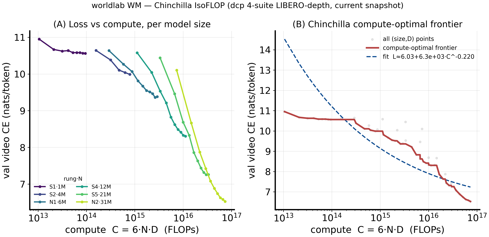

**Small and medium rungs, capped at D ≤ 20N** (`chinchilla_flops_20N_S1N5`): S1 to N5, 1.2M–679M.

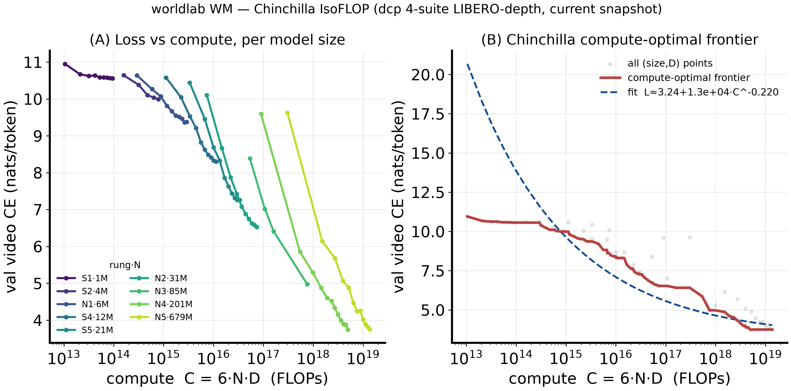

**Full ladder, uncapped** (`chinchilla_flops`): S1 to N9, 1.2M–6.0B.

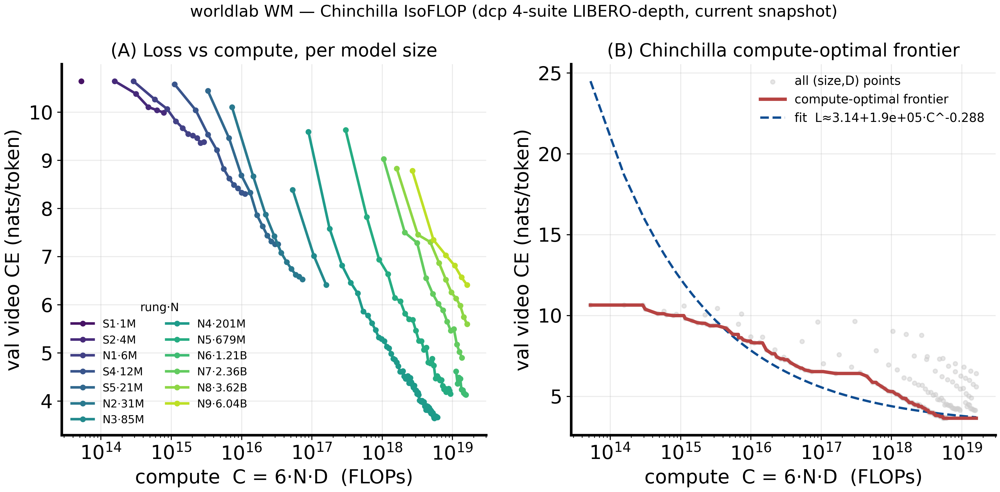

Other variants in the same folder: `_20N_S1N3`, `_20N_S1N4`, `_20N_S2N2`, `_smallS1N3`, and `_dotted_merged`
(the long 1-GPU runs joined to the short runs with dotted lines).

| Figure | Rungs | Frontier fit |
|---|---|---|
| 20N_S1N2 | S1–N2 (≤31M) | L ≈ 6.03 + 6.3e3·C^−0.220 |
| 20N_S1N5 | S1–N5 (≤679M) | L ≈ 3.24 + 1.3e4·C^−0.220 |
| full | S1–N9 | L ≈ 3.14 + 1.9e5·C^−0.288 |
| dotted_merged | S1–N9, plus long 1-GPU runs | L ≈ 3.14 + 1.3e5·C^−0.280 |

What the figures show:
- **The frontier is set by successively larger models as compute grows.** In (A), each larger rung starts higher and
  falls more steeply, then crosses below the smaller rung's curve. This is the Chinchilla picture. The update below
  confirms it with finished runs: N4 is on the frontier from ~1.2e18 to ~1.6e19 FLOPs, and N5/N6 only above that.
- **Below ~3e14 FLOPs the frontier is flat at ~10.6.** Those points are S1/S2 in their first ~100 steps, where loss
  has barely moved from its starting value.

How to read the fit:
- **E is not fitted.** `make_chinchilla_flops.py` fixes E = (lowest loss in the plot) − 0.5 and fits only a and b, in
  log-space, on the frontier. E = 3.14/3.24/6.03 is therefore set by the best run in each figure. The exponent
  b = 0.22–0.29 depends on that choice.
- **The fit misses the low-compute end.** At 1e13–1e15 FLOPs the dashed line sits far above the frontier (up to ~20
  vs ~10.6), so it describes only the upper part of the frontier.
- A fit that frees E needs annealed endpoints at several budgets (see the last section).

What the small-rung points are:
- **The short runs saw D = 12.4N, not 20N.** The S1–N2 curves in these figures are the short "20N" runs (see "The
  '20N' runs" below). With the "≤ 20N" cap, the medium and large rungs are cut at 20N; the small rungs never reached
  20N at all.
- **The small-rung curves stop high.** S1–N2 end at 6.5–10.6 nats, while the 8-GPU rungs reach 3.3–3.7. Part of the
  gap between the left and right ends of the frontier is therefore short schedules, not model size.
- **The N3 curve can't be reproduced from today's data.** In the Oct 3 plots it goes down to ~5.0 at ~8e17 FLOPs.
  Its short run stopped at 6.41, and its 100k run is recorded in wandb today only up to 5k steps, with no val point.
  The source data (`/tmp/scaling_raw.txt`) no longer exists.

## Model size, PSNR and shape at 0.15B tokens (study figures)

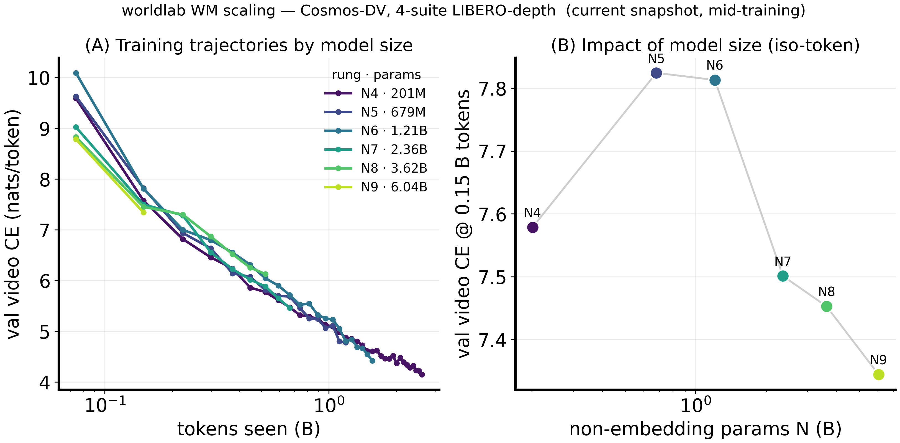

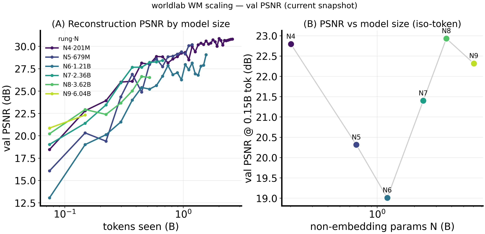

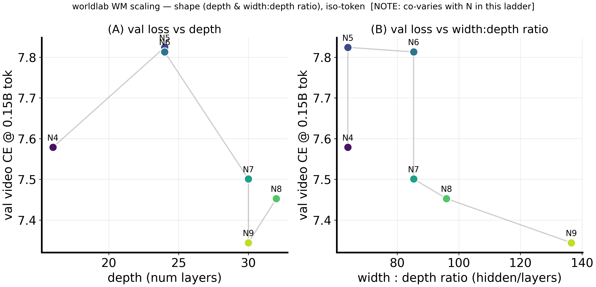

- **All panel-(B) values are at 0.15B tokens.** That is 1k steps, the end of warm-up, set by the least-trained rung
  (N9) at the time. Loss there ranges 7.35–7.83, non-monotonic in N. PSNR ranges 19–23 dB, with N6 the lowest. This
  is too early to show capacity, and the update shows the order changes twice later (see the iso-token table).
- **Panel (A) of the model-size plot already shows the curves bunching up.** By ~1B tokens N4–N7 lie within ~0.3
  nats of each other.
- **The shape plot cannot separate depth or width:depth from size.** In this ladder they change together with N, as
  its own title says, so depth and shape are not isolated.

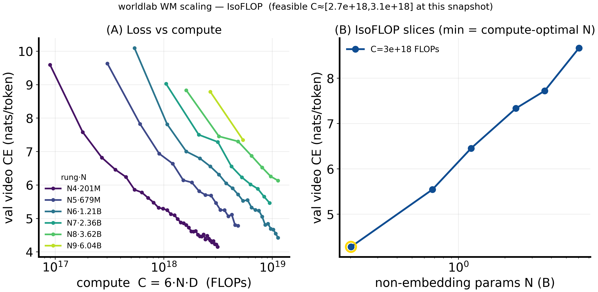

- **At C ≈ 3e18 FLOPs, the only budget all six large rungs shared on Oct 1, N4 has the lowest loss** (4.3 vs 8.7 for
  N9). This matches the frontier result above. It is a slice through mid-schedule curves, not annealed endpoints.

## Training curves (update)

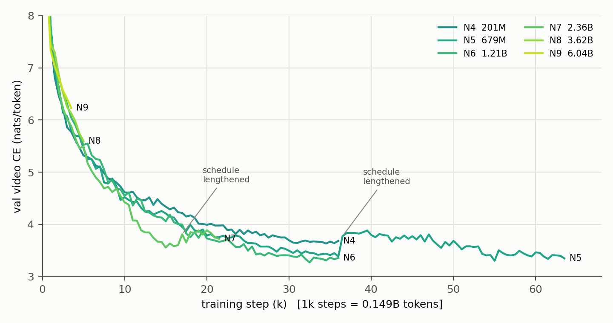

Two curves are distorted by resumes that **changed `cfg.steps`**. The cosine LR depends on the total step count, so
the LR jumps back up and the loss rises:
- **N5:** at 36k, the run was resumed on a 100k schedule (LR 0 → ~0.7×peak). Loss went from 3.38 to 3.83 and took
  until 63k steps to come back to 3.35.
- **N7:** switched between the 18k and 36k schedules. At 17k it was resumed on the 36k schedule (LR ~0 → ~0.6×peak),
  and loss went from 3.58 to 3.85.

Neither is a capacity effect. Points after the switch are not used for model-size comparisons.

## Loss vs model size at a fixed token budget (update)

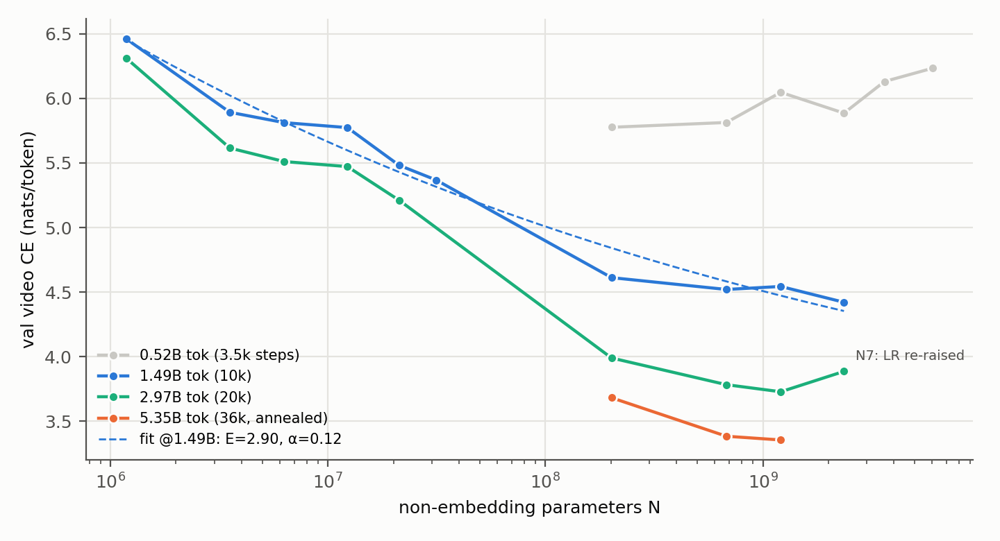

| Tokens (steps) | S1 1.2M | S2 3.5M | N1 6.3M | S4 12M | S5 21M | N2 31M | N4 201M | N5 679M | N6 1.21B | N7 2.36B | N8 3.62B | N9 6.04B |
|---|---|---|---|---|---|---|---|---|---|---|---|---|
| 0.52B (3.5k) | | | | | | | **5.776** | 5.813 | 6.046 | 5.885 | 6.130 | 6.233 |
| 0.74B (5k) | | | | | | | **5.318** | 5.461 | 5.523 | 5.493 | 5.594 | |
| 1.49B (10k) | 6.461 | 5.892 | 5.812 | 5.773 | 5.482 | 5.368 | 4.612 | 4.520 | 4.544 | **4.421** | | |
| 2.97B (20k) | 6.311 | 5.615 | 5.510 | 5.472 | 5.211 | | 3.990 | 3.783 | **3.729** | 3.886† | | |
| 5.35B (36k, annealed) | | | | | | | 3.682 | 3.384 | **3.356** | | | |

† N7 at 20k is after its LR was raised again; not comparable.

- **Early on, smaller is better.** Larger rungs have a lower μP LR and more parameters to fit, so at the same small
  token count they are behind. The crossover happens between 0.74B and 1.49B tokens.
- **At the end of a matched schedule, larger is better, with diminishing returns.**

  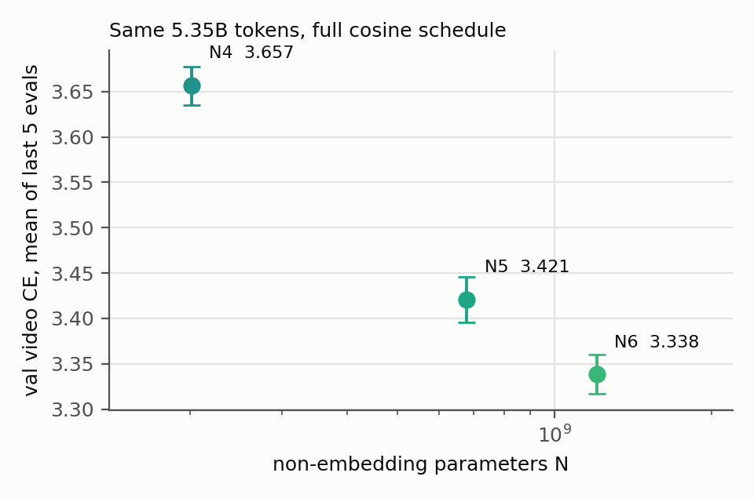

  | Rung | N | Mean of last 5 evals (34–36k, LR < 2% of peak) | sd |
  |---|---|---|---|
  | N4 | 201M | 3.657 | 0.021 |
  | N5 | 679M | 3.421 | 0.025 |
  | N6 | 1.21B | 3.338 | 0.022 |

  3.4× more parameters gives −0.236 nats; a further 1.8× gives −0.083. Three points with three free parameters
  (E, A, α) cannot be fit honestly, so I don't quote an exponent from them.
- **Power-law fit at 1.49B tokens** (the only budget with 10 rungs):

  | Fit | E | α | RMSE |
  |---|---|---|---|
  | all 10 rungs | 2.90 | 0.12 (90% CI 0.02–0.26) | 0.11 |
  | 1-GPU rungs only (≤31M) | 4.68 | 0.26 | 0.08 |

  The small-rung fit predicts 5.14 / 5.01 / 4.97 / 4.92 for N4 / N5 / N6 / N7. The measured values are 4.61 / 4.52 /
  4.54 / 4.42, about 0.5 nats better. Between 31M and 201M the curve gets steeper, not flatter. N3 (85M), the one
  point that would show where this happens, has no data. The two ladders also differ in warm-up (2k vs 1k), in LR
  schedule position at 10k (98% vs 85% of peak), and in GPU count (1 vs 8 at the same global batch), so this jump
  cannot yet be attributed to model size alone.

## Loss vs compute (update)

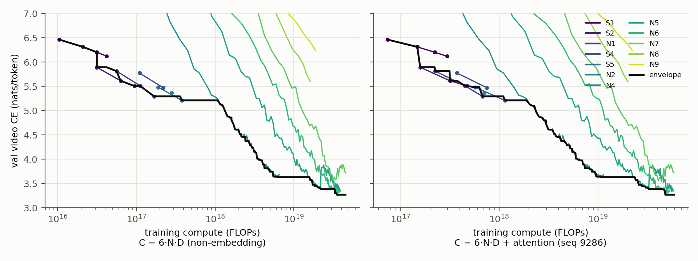

The black line is the lower envelope: the best loss any run reached at or before that compute.

| Compute (6ND) | Rung on the envelope |
|---|---|
| 1e16 – 4e17 | S1 → S2 → N1 → S5 (≤21M) |
| ~1.2e18 – 1.6e19 | **N4** (201M) |
| ≥ 1.6e19 | N5 (679M), then N6 (1.21B) from ~3.3e19 |

- **The compute-optimal size grows with compute**, as Chinchilla predicts. Where the switch from ≤31M to N4 happens
  between 4e17 and 1.2e18 is unknown: N3 is missing and the 1-GPU runs only log val every 10k steps.
- **Most curves on the envelope are mid-schedule.** Only N4/N5/N6 at 36k are annealed endpoints. A curve sampled
  mid-cosine sits above where a run annealed at that budget would end, so the true frontier is lower and may switch
  sizes at different compute levels.
- **6ND undercounts compute.** Each sample is 9,286 tokens long. Attention (6·layers·seq·hidden per token, Kaplan
  2020) adds 16% of FLOPs at N9, 43% at N4 and up to 86% at S1. The right panel includes it: the order of the rungs
  on the envelope stays the same, and the small rungs move right. Neither panel counts the 131k-vocab tied output
  head, the MTP heads, or the frozen Cosmos/DINO forward passes.

Total compute per finished run (6ND / with attention): N4 6.5e18 / 1.1e19, N5 (36k) 2.2e19 / 3.3e19, N6 3.9e19 / 5.3e19.

## The "20N" runs

Seven short runs (`wl_scale1g_*` created 2026-10-01, plus `S1_20Nfine` on 2026-10-02) were meant to train each small rung to
D = 20N on its own short cosine schedule. Their step counts were planned with **~240k tokens per step**; the real
figure is **148,576**. As a result they saw **D = 12.4N**, not 20N. They are also far from converged (S1: 10.56 after
90 steps; N2: 6.53 after 2.6k steps; N3 crashed at 2.1k of 7.1k). They are left out of the curves and fits above,
and should not be used as Chinchilla-optimal points.

## How the measurement works (and its limits)

- **Validation set:** `val_video` is computed on the main process only, from the first 4 batches × 2 clips = 8 clips
  of the held-out split, in a fixed order (no shuffling), so every run sees the same clips. MaskGIT masks are drawn at
  random for each eval. The spread of the last five annealed evals gives a noise sd of **0.022**. Differences of
  ≥0.07 (3 sd) are reliable; absolute values describe only these 8 clips.
- **Data:** the rungs see 0.5–9.4B tokens of the same 4-suite LIBERO set, repeated over several epochs (the exact count was not measured here). Repeated tokens
  are worth less than new ones, so the token axis here is not "unique data".
