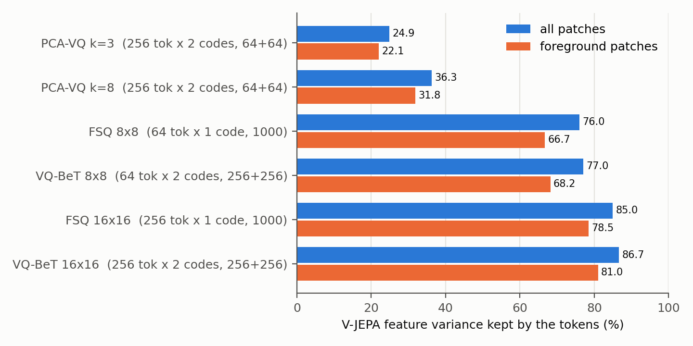
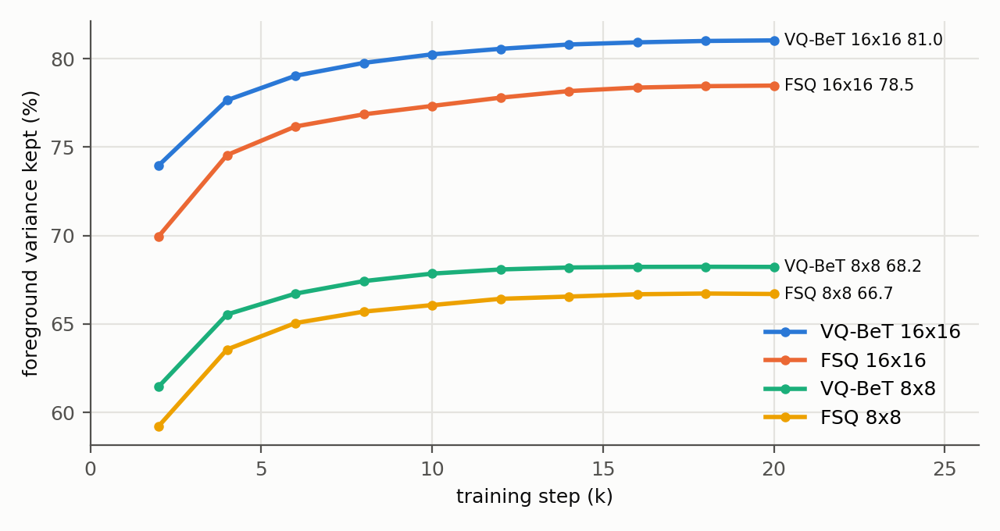
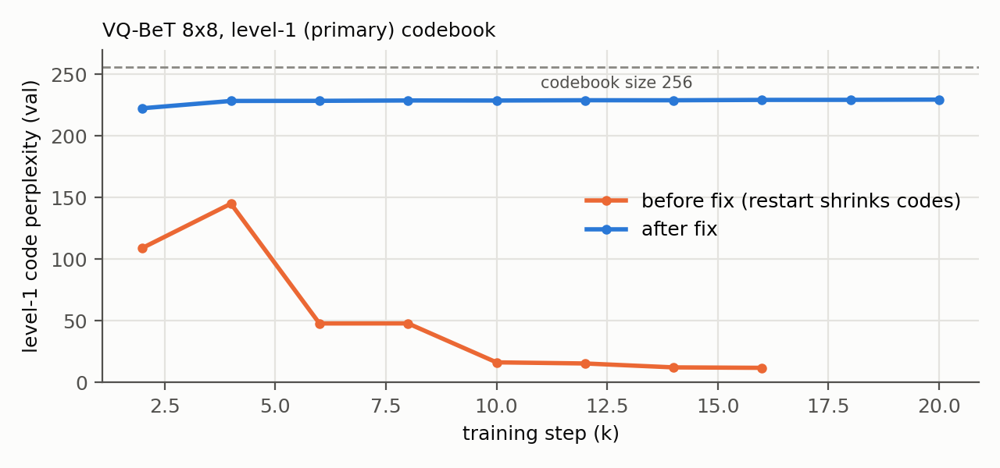
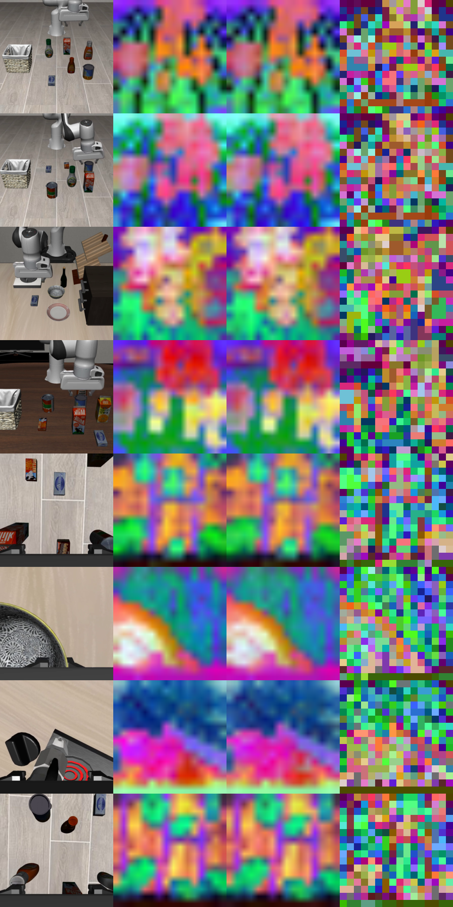
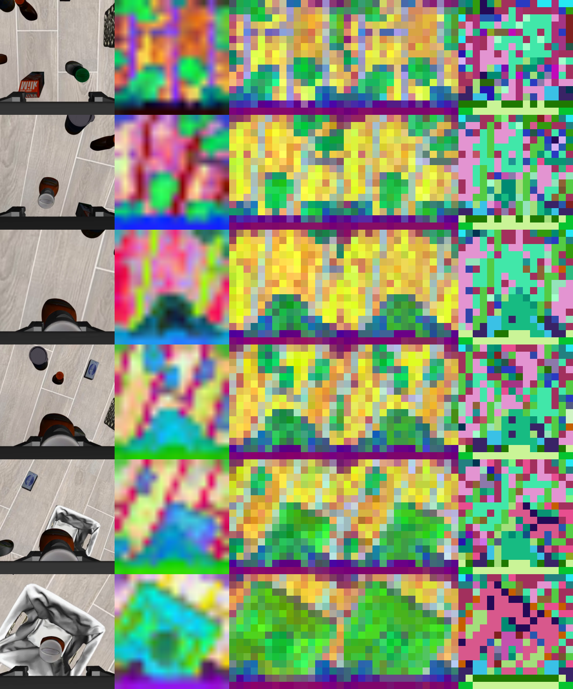
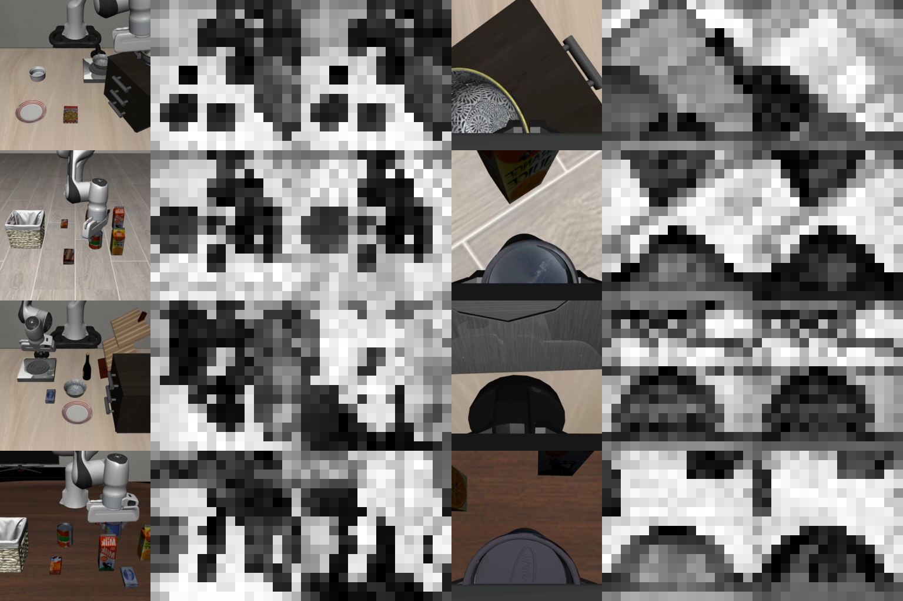
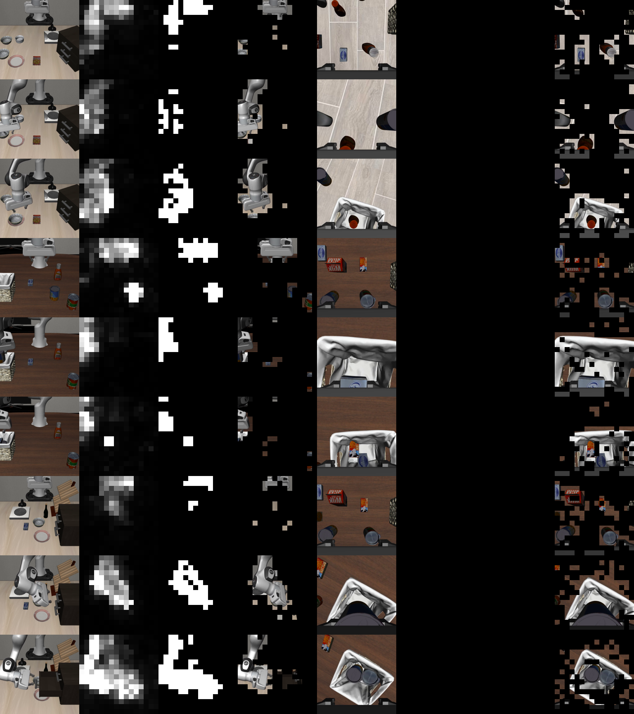
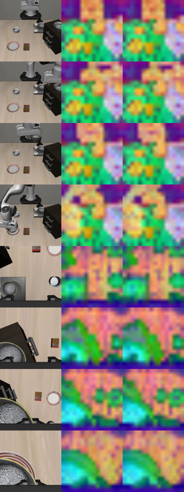
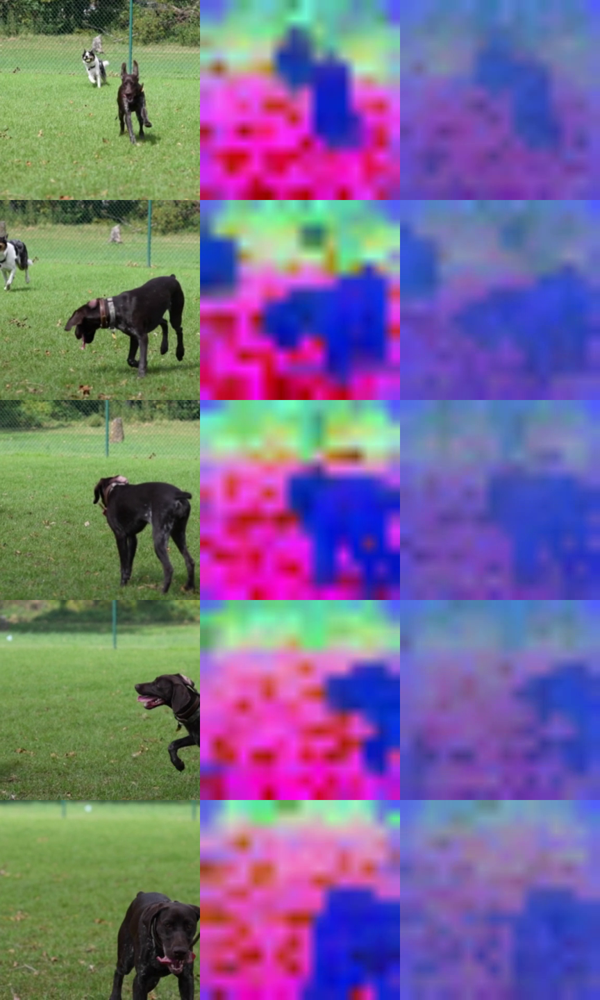

# VQ-JEPA: discrete patch tokens from a frozen V-JEPA 2.1 encoder

Goal: turn each camera frame into a small set of discrete tokens (VQ-BeT style: code + continuous offset) that keep as
much of the V-JEPA 2.1 patch features as possible, so the multistream world model can use them like the DINO stream.
Reconstruction is in V-JEPA feature space (no pixels). All numbers are on LIBERO (4 suites, both cameras), RTX A6000.

## Summary

| Tokenizer | Tokens / frame / cam | Codes / token | Variance kept, all | Variance kept, foreground |
|---|---|---|---|---|
| PCA-VQ, k=3 (fixed PCA + residual k-means) | 256 | 2 (64 + 64) | 24.9% | 22.1% |
| PCA-VQ, k=8 | 256 | 2 (64 + 64) | 36.3% | 31.8% |
| FSQ autoencoder 8x8 | 64 | 1 (1000) | 76.0% | 66.7% |
| **VQ-BeT autoencoder 8x8** | **64** | 2 (256 + 256) | **77.0%** | **68.2%** |
| FSQ autoencoder 16x16 | 256 | 1 (1000) | 85.0% | 78.5% |
| **VQ-BeT autoencoder 16x16** | **256** | 2 (256 + 256) | **86.7%** | **81.0%** |

Held-out set: 60 videos (1,666 frames) never used for fitting/training. Codes only (VQ-BeT offset not added).

- **Recommended: VQ-BeT 16x16.** Same token layout as the current DINO stream (DINOv2-base at 224 px = 16x16 patches
  per camera), 86.7% / 81.0% variance kept, both codebooks fully used.
- **VQ-BeT 8x8** gives 4x fewer tokens for about 13 points less foreground variance.
- A learned tokenizer is needed: the linear PCA route is capped by the PCA itself (top 8 components explain 39%).
- On an unseen robot episode the tokens keep 90.7% (front camera) and 81.3% (wrist) of the features. On a real-world
  dog video they keep **-38%**: the tokenizer is LIBERO-specific (Section 6).



## 1. Encoder and preprocessing

| | |
|---|---|
| Model | V-JEPA 2.1 ViT-Base 384 (`vjepa2_1_vit_base_384`, facebookresearch/vjepa2), frozen |
| Weights | `vjepa2_1_vitb_dist_vitG_384.pt`, key `ema_encoder` (distilled from the ViT-G teacher), loaded strict |
| Preprocessing | official `vjepa2_preprocessor`: resize short side to 292, center-crop 256, ImageNet normalization |
| Input | one frame as `(B,3,1,256,256)` (image mode: image patch-embed, no tubelets), fp32 |
| Output | 16x16 = 256 patch features x 768 per frame; V-JEPA 2.1 has no CLS token |

The hub's `pretrained=True` downloads from `VJEPA_BASE_URL = http://localhost:8300`, so the encoder is built with
`pretrained=False` and the released file is loaded from `dl.fbaipublicfiles.com` with the hub's own key cleaning.

**Match to the reference PCA script** (`pca_patch_visualize.py`, the original content of `vq_jepa.py`). On LIBERO
frames, our features are bit-identical to the script's for single frames (max difference 0); batched frames differ
by at most 1.3e-4 (fp32 batched matmul). The script itself did not run on V-JEPA 2.1: its output parser unsqueezes a
`(1, 256, 768)` tensor twice, giving 5-D, and raises `Unable to reshape encoder output`. The comparison used the
script with that one line fixed in memory; the script file was not changed.

## 2. Data and metric

- **Feature cache:** 600 training videos (16,398 frames) and 60 held-out videos (1,666 frames), all 4 suites, both
  cameras (`cam_high`, `cam_left_wrist`), every 6th frame. Split by video (seed 0).
- **Variance kept** = 1 - SSE / SST over the 768-d features, with SST about the held-out mean (R^2). 100% = exact
  features, 0% = no better than the mean feature.
- **Foreground** = patches a background classifier marks as moving things (Section 5). The foreground metric is
  reported because most patches are floor and table.

## 3. Learned tokenizers (FSQ and VQ-BeT)

```
V-JEPA features 16x16x768 -> standardize -> [merge 2x2 for 8x8] -> Linear(512) -> 4 transformer layers
  -> quantizer -> 4 transformer layers -> Linear -> [unmerge] -> 16x16x768
```

| Quantizer | Details |
|---|---|
| FSQ | levels [8,5,5,5] = 1000 codes per token; input = learned projection + PCA of the pooled features (step 0 = quantized PCA) |
| VQ-BeT (residual VQ) | 2 levels x 256 codes, 32-d, EMA codebooks, LayerNorm on the quantizer input, dead-code restart below 10% of uniform usage; the continuous VQ-BeT offset (target - decoded codes) is left for the world model |

Training: 20k steps, batch 64 frames, AdamW lr 3e-4 (1k warmup, cosine), per-patch MSE on standardized features
weighted 1 + 4 x p(foreground). 26-28M parameters. 8x8 ran about 35 min and 16x16 about 75 min, two runs sharing
one A6000.



- VQ-BeT beats FSQ at both sizes (+2.5 points foreground at 16x16, +1.5 at 8x8) with a smaller per-code vocabulary.
- 8x8 runs plateaued by 16k steps. 16x16 runs were still rising slowly at 20k (+0.1 point per 2k steps).
- Code usage on held-out data: 100% for every run. Perplexity: FSQ 708 (8x8) and 763 (16x16) of 1000; VQ-BeT 229 / 215
  (8x8) and 235 / 211 (16x16) of 256 for levels 1 / 2.

### VQ-BeT codebook bug and fix

The first VQ-BeT runs lost most of their level-1 (primary) codes: 8x8 fell to 6.6% usage (perplexity 12 of 256) while
reconstruction stayed normal, because level 2 and the decoder compensated. Diagnosis on the quantizer inputs: input
norm median 5.66, but most level-1 code vectors had norm 0.23-0.30; offline k-means on the same inputs used all 256
codes (perplexity 217). Cause: the dead-code restart set `embed_avg = r` with `cluster_size = n/K`, and the next EMA
update divides them, shrinking every restarted code to r/16 (norm ~0.35). Fixed by `embed_avg = r * n/K`
(`vq_jepa_fsq.py`, `EMAVQ.forward`). All VQ-BeT numbers in this report are from the fixed runs.



## 4. Qualitative check

Columns: input (preprocessed) | per-image PCA of the original features (reference script) | the same PCA basis applied
to the features decoded from the tokens | level-1 token map (code colored by PCA of its codebook vector).



Columns 2 and 3 are nearly indistinguishable at 16x16. The token map (column 4) is not object-segmented: neighboring
patches with the same content often get different codes, because each code comes from a learned latent that mixes
in context. Judge quality from column 3, not from the raw code map.

## 5. Earlier steps

**PCA-VQ (PCA-RGB tokens).** Fixed global PCA on the patch features (sklearn, the reference script's math: centered,
1/99 percentile scaling), then residual k-means 64 + 64 on the PCA coordinates. The PCA must be fit once over the
dataset: the reference script's per-image PCA changes axes, signs and scaling every frame, so its colors cannot serve
as tokens. Explained variance: top 3 = 25.1%, top 8 = 39.1%. The global PCA image is noisier than the per-image one
(column 3 vs column 2 below) because 3 directions have to cover both cameras and all suites.



**Background removal.** The first PCA component does not separate foreground from background in LIBERO (cluttered,
textured scenes), so the DINOv2 thresholding recipe does not apply.



**Motion-labelled background classifier.** Labels from the static front camera: a patch is foreground when its feature
departs from its per-episode temporal median (1 - cos > 0.151, Otsu; 13% of patches). A logistic regression on single-
frame features then predicts foreground on either camera. Held-out episodes: accuracy 91.4%, balanced accuracy 91.0%,
foreground IoU 0.59. It finds the robot and gripper well but labels static objects as background, including the
manipulated object before it moves. It is used only as a loss weight and for the foreground metric.



## 6. Videos: robot task vs real-world footage

Same model (VQ-BeT 16x16), every frame, one PCA fit over the whole video on the original features and applied to both
columns. Columns: input | PCA of original | PCA of decoded tokens.

| Video | Frames | Variance kept | Cosine |
|---|---|---|---|
| LIBERO-spatial episode 414, front camera (unseen) | 124 | 90.7% | 0.985 |
| LIBERO-spatial episode 414, wrist camera (unseen) | 124 | 81.3% | 0.970 |
| Real-world dog video (3840x2160, 24 fps) | 533 | -38% | 0.80 |

Task: "pick up the black bowl on the wooden cabinet and place it on the plate". Rows 1-4 front camera, rows 5-8 wrist,
frames 0 / 40 / 80 / 120:



Dog video, frames 0 / 130 / 260 / 390 / 520:



V-JEPA describes both videos well (column 2 is clean in both). The tokenizer was trained on LIBERO frames only, so real
grass, fur and trees have no matching codes: each patch snaps to the nearest LIBERO-like code, which keeps the dog's
outline but loses contrast and shifts the features toward the LIBERO mean (hence below 0%). Real-world use needs
training data from that domain; the encoder can stay.

## Limitations and open items

- No temporal objective yet: tokens are per frame. Planned: rebuild V-JEPA video features from tokens t-K..t.
- The VQ-BeT continuous offset was not evaluated; all numbers use codes only.
- One seed per configuration; differences under about 1 point are not resolved.
- The foreground metric depends on the motion classifier (IoU 0.59), which misses static objects.
- Only ViT-B was tested. Larger V-JEPA 2.1 encoders (L, g, G) need a new cache and retraining (different feature size
  and space), and would add encoder latency per decision.
- Not yet connected to the world model. Wiring the tokens in as a `dino_patch`-style VQ-BeT stream changes core model
  code and needs a separate plan.

## Reproduction

Code: `worldlab/components/encoders/vq_jepa.py` (encoder, PCA-VQ, background classifier) and
`worldlab/components/encoders/vq_jepa_fsq.py` (feature cache, FSQ / VQ-BeT autoencoder, video tool). Run from
`worldlab/components/encoders/` with `PY=/nvme-data/flexpi-eval-venv/bin/python`.

```bash
$PY vq_jepa.py fit --k 8 --out /nvme-data/Komal/wm/vq_jepa/strict/pca_vq_k8_64x64.pt        # PCA-VQ
$PY vq_jepa.py bgmask --out /nvme-data/Komal/wm/vq_jepa/strict/bg_probe.pt                   # motion classifier
for i in 0 1 2 3; do $PY vq_jepa_fsq.py cache --split train --shard $i --n_shards 4 & done    # feature cache
$PY vq_jepa_fsq.py cache --split val
$PY vq_jepa_fsq.py train --quant rvq --merge 1 --rvq_norm --rvq_dead_thr 0.1 --out /nvme-data/Komal/wm/vq_jepa/rvq_v2/g16
$PY vq_jepa_fsq.py train --quant fsq --merge 2 --out /nvme-data/Komal/wm/vq_jepa/fsq/g8
$PY vq_jepa_fsq.py video --video <mp4> --ckpt /nvme-data/Komal/wm/vq_jepa/rvq_v2/g16/best.pt --out <out.mp4>
/nvme-data/flexpi-eval-venv/bin/python benchmarking/figures/make_vq_jepa.py                 # figures (from worldlab/)
```

| Artifact | Path (under `/nvme-data/Komal/wm/vq_jepa/`) |
|---|---|
| Feature cache | `cache/{train,val}_shard*.npy` (6.5 GB) + `_meta.json` |
| PCA-VQ, background classifier | `strict/` |
| FSQ runs | `fsq/{g8,g16}/` (`best.pt`, `last.pt`, `log.jsonl`, `viz.png`) |
| VQ-BeT runs (fixed) | `rvq_v2/{g8,g16}/` |
| VQ-BeT runs (before the fix, superseded) | `rvq/` |
| Videos | `rvq_v2/g16/*.mp4` with `_tokens.npy` and `_stats.json` |
| PCA-VQ scored on the shared held-out set | `pca_vq_on_cache_val.json` |
